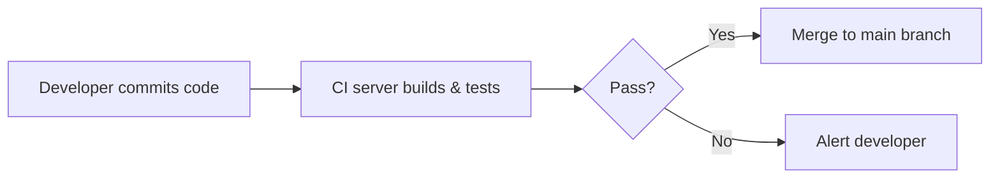
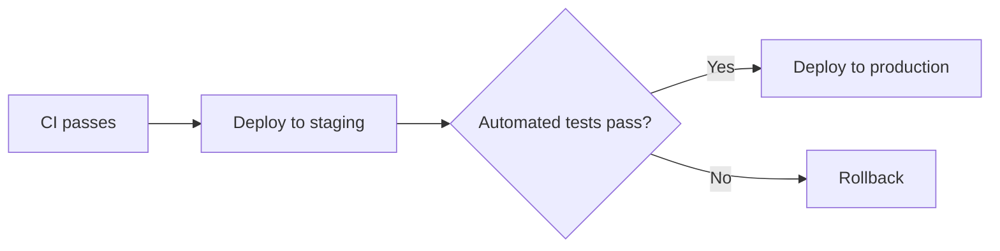

# CI/CD

- **CI** = "Is my code working?" → automated building and testing.
- **CD** = "Can we ship it?" → automated delivery/deployment.
- Together: faster, safer releases.

|              | CI (Continuous Integration) | CD – Continuous Delivery          | CD – Continuous Deployment          |
|--------------|-----------------------------|-----------------------------------|-------------------------------------|
| Primary goal | Catch bugs early            | Always have a releasable build    | Ship every passing change           |
| Automation   | Build + test                | Build + test + deploy to staging  | Build + test + deploy to production |
| Human role   | None                        | Manual approval before production | None                                |
| Output       | Tested code in the repo     | Release-ready artifact            | Code running in production          |
| Typical for  | Everyone                    | Regulated settings (e.g. banking) | SaaS / startups                     |

## CI

Developers frequently merge into a shared repository (GitHub/GitLab); every merge/PR triggers automated build and tests.
Benefits: automated unit/integration tests, fast feedback on quality, avoids "integration hell".

## CD

- **Continuous Delivery** – code is always deployable, release is triggered manually (approvals).
- **Continuous Deployment** – code is deployed to production automatically after CI passes.

Benefits: automated deployments (staging → production), faster releases with minimal manual steps, software always in a
releasable state.

Tools: GitHub Actions, GitLab CI, Jenkins, Cloud Build, AWS CodePipeline. Commit convention that helps release
automation: [Conventional Commits](../tools/git-commit-messages.md).
